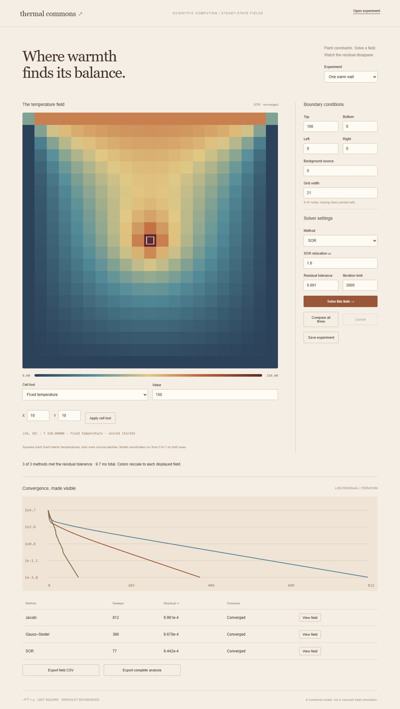

# Thermal Commons

A scientific-computing workbench for steady-state Poisson fields on a unit square. Set boundary temperatures, paint interior constraints or source patches, compare three stationary solvers, and inspect convergence rather than trusting a heatmap alone.



## Run

Python 3.10+; no packages or build step:

```sh
python run.py
```

Open http://127.0.0.1:8000. Solves run in a browser worker. The local server only serves five static assets, and experiments never leave the browser.

## Use the workbench

- Choose a warm-wall, uniform-source, or fixed-hot-center experiment.
- Set four constant edge temperatures and a background source. Corners average the two adjacent edges. Grid width is 5–41 nodes; resizing clears painted cells.
- Inspect or paint interior cells using the canvas or explicit X/Y controls. A cell can hold one fixed temperature or one additive source patch. Erase returns it to the background model.
- Solve with Jacobi, Gauss–Seidel, or SOR, or compare all three from the same initial guess. View each final field separately; method colors match convergence curves.
- Inspect absolute PDE residuals, iteration counts, and explicit convergence/iteration-limit outcomes. The chart is logarithmic; exports retain every iteration even when the display decimates long curves.
- Save/reopen an experiment, export every grid node as CSV, or export all method results and histories as JSON. Source edits invalidate prior results. Cancel terminates the worker.

The color scale rescales to each displayed field. Compare the numeric endpoints and residuals; equal colors in different runs do not imply equal temperatures.

## Discretization and solver semantics

The modeled equation is `−∇²T = q` on `[0,1] × [0,1]` with fixed Dirichlet boundaries and optional fixed interior nodes. Coordinates increase rightward and downward. Values are model units; this is not a material-specific thermal engineering model.

With `h = 1/(N−1)`, each free node satisfies:

```text
4 T[i,j] − T[i−1,j] − T[i+1,j] − T[i,j−1] − T[i,j+1] = h² q[i,j]
```

The initial free-node value is the average of the four edge temperatures. Fixed nodes are never updated. Source patches add to the background source at one grid node, so changing grid resolution changes their physical footprint; they are not resolution-independent point-source strengths.

- **Jacobi** uses values from the preceding full sweep, with a second buffer.
- **Gauss–Seidel** updates in place in row-major order.
- **SOR** applies `old + ω(target − old)` in the same order; `ω=1` is exactly Gauss–Seidel. Allowed ω is 0.1–1.95. A larger ω is not guaranteed to be faster.

Stopping requires the maximum absolute free-node defect in the original PDE equation, `|(4T−neighbors)/h² − q|`, to be at most the requested tolerance. A small update alone does not count as convergence. The tolerance is 1e−6…1 and the sweep cap is 1…5,000. A field already satisfying the equations completes with zero sweeps. Fixed nodes are excluded from residual evaluation.

This finite-difference approximation has spatial discretization error even when the algebraic residual is tiny. The app does not model time-dependent diffusion, variable conductivity, convection, radiation, flux boundaries, or mesh refinement/error estimation.

## Architecture

`core.js` validates experiments, assembles bounded Float64 fields, implements all three solvers, evaluates residuals, and creates CSVs. `worker.js` isolates numerical work. The UI maintains raw model constraints separately from solved fields and uses revision checks to ignore stale work and imports. Bounds cap the grid at 1,681 nodes and comparison histories at 15,003 samples.

Experiments contain `{scene, settings}`. A scene has `size`, four-value `boundary`, background `source`, `pins:[{x,y,temperature}]`, and `sources:[{x,y,strength}]`. Settings contain `method`, `omega`, `tolerance`, and `maxIterations`. Temperatures are bounded to −100…500; source values and combined per-node sources to −10,000…10,000. Painted cells must be unique and strictly interior.

## Verification

Node.js 22+ is required for development checks:

```sh
npm test
npm run check
python -m unittest discover -s tests -p "test_*.py"
```

11 JavaScript tests verify all methods against an independent dense elimination solver, a manufactured quadratic Poisson solution, exact fixed constraints, zero-sweep uniform fields, SOR/GS equivalence at ω=1, symmetry, the zero-source maximum principle, explicit iteration limits, independently evaluated residuals, strict bounds, immutability, determinism, and CSV coverage. One Python integration test verifies static asset boundaries, HEAD, Host checks, and content policy. CI runs on Linux and Windows.

Browser checks cover comparisons, painted constraints, experiment save/reload, explicit nonconvergence, and downloads. A separate Python check verified the 441 exported grid nodes, a fixed 150-unit center, and the PDE residuals for all three exported methods.

## Background

The stationary-iteration descriptions follow [Netlib's Templates for the Solution of Linear Systems](https://www.netlib.org/templates/templates.html), Section 2.2. The implementation and validation oracles in this repository are independent.
